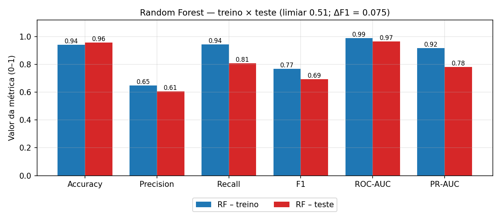
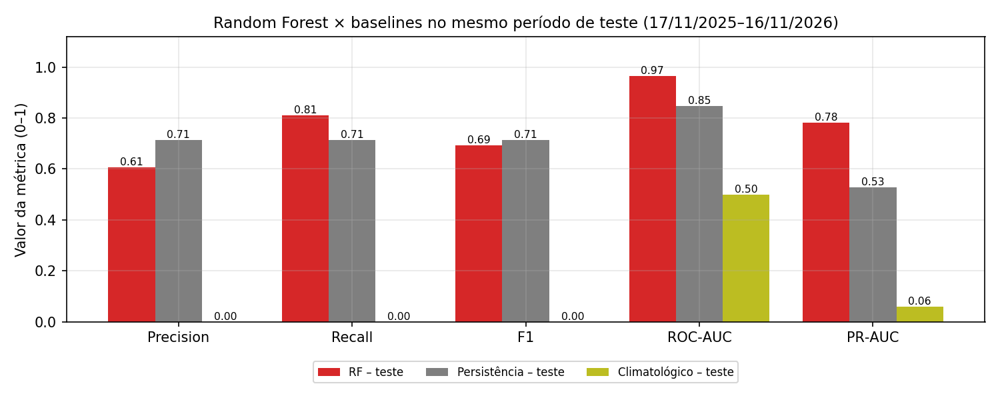
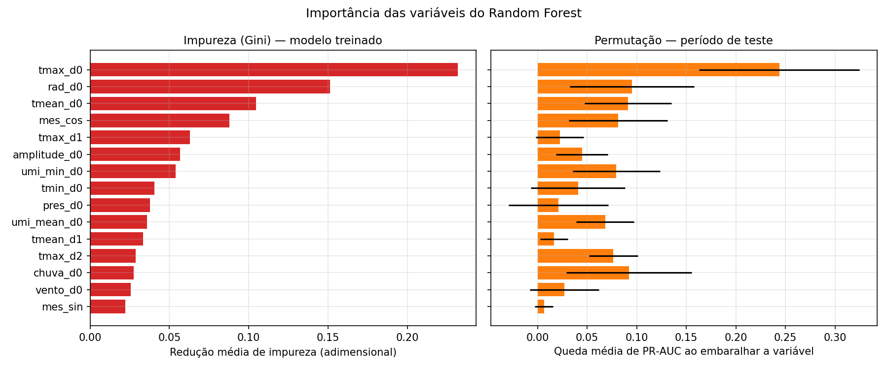
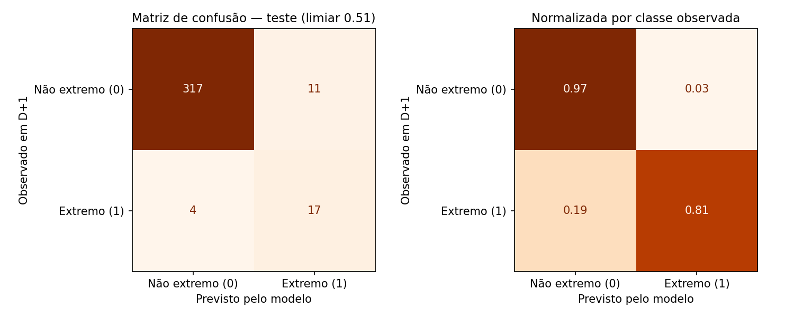

# Sereno SP — Relatório de Machine Learning
**Previsão de calor extremo para o dia seguinte · Estação INMET A701 (Mirante de Santana)**
Global Solution 2026 · FIAP · Inteligência Artificial & Machine Learning · Modelo `sereno-rf-1.0`

| Integrantes | RM |
|---|---|
| Arthur Bobadilla Franchi | RM555056 |
| Luan Orlandelli Ramos | RM554747 |
| Jorge Luis | RM554418 |

> Todos os números deste relatório foram extraídos de `reports/metricas.json` e das saídas de
> `notebook_sereno_calor.ipynb`, executado integralmente em 17/11/2026 (33 células, 0 erros, `random_state=42`).

## 1. Introdução e problema social
Idosos (60+) e trabalhadores de rua do distrito de Santana (zona norte de São Paulo) ficam expostos ao calor
extremo sem aviso antecipado. O Sereno SP quer avisar **na véspera**, dando tempo para hidratação, mudança de
horário de trabalho e cuidado com quem mora sozinho.

## 2. Pergunta de Machine Learning
*Com as condições observadas hoje (D) e nos dois dias anteriores na estação A701, amanhã (D+1) será um dia de calor
extremo?* — classificação binária (`extremo_amanha` ∈ {0, 1}) com probabilidade via `predict_proba()`.

## 3. Fonte e características dos dados
| Item | Valor |
|---|---|
| Fonte | INMET — Tabela de Dados das Estações (`tempo.inmet.gov.br/TabelaEstacoes/A701`), dados públicos |
| Estação | A701 — São Paulo – Mirante (automática) |
| Arquivos | 7 CSVs semestrais (limite de 6 meses por consulta), 17/05/2023 → 17/11/2026 |
| Obtenção | arquivos exportados pelo autor em 17/11/2026; acesso automático ao portal a partir do ambiente de execução retornou HTTP 403 (registrado no notebook) |
| Formato real | UTF‑8 com BOM, sem metadados, `;` e decimal `,`, hora em UTC |
| Variáveis | temperatura, umidade e ponto de orvalho (inst./máx./mín.), pressão, vento (vel./dir./rajada), radiação (kJ/m²), chuva (mm) |
| Linhas lidas | 30.888 horárias → 30.744 horas únicas (linha do tempo completa) |

Não houve troca de estação: a A701 tem cobertura suficiente (1.264 de 1.282 dias válidos).

## 4. Preparação e limpeza
* **Duplicatas:** 144 (o dia de sobreposição entre arquivos), todas idênticas → removidas.
* **Sentinela −9999 e valores fora de faixa física:** 0 ocorrências (verificado por variável).
* **Ausências:** 372 horas sem temperatura (1,2%); radiação vazia à noite (esperado).
* **Fuso:** UTC → `America/Sao_Paulo` (UTC−3); o dia diário é o **dia civil local**.
* **Exclusão:** dias com > 25% das horas ausentes (< 18 h válidas) → **18 dias excluídos** (incluindo os dias
  parciais das bordas, 16/05/2023 e 17/11/2026). Radiação diária anulada em 10 dias com lacuna entre 10h e 15h; chuva
  anulada em 20 dias. **Nenhum valor foi imputado.**
* **Agregação diária:** Tmax, Tmin, Tmédia, UR mín./média, chuva acumulada, radiação acumulada (MJ/m²), vento médio, pressão média.
* **Atributos (15):** Tmax/Tmin/Tmédia de D; Tmax e Tmédia de D‑1; Tmax de D‑2; UR mín./média, chuva, radiação, vento,
  pressão e amplitude térmica de D; mês em seno/cosseno. Defasagens feitas por **data de calendário**; um teste
  automatizado confirma que alterar D+1 não muda os atributos de D.

## 5. Variável‑alvo
`extremo_amanha = 1` se **Tmax(D+1) ≥ P90 das Tmax diárias do treino**. O limiar foi calculado **após** a divisão,
com 902 dias válidos do treino: **32,9 °C**. Esse valor é um critério estatístico local, não um limite oficial de onda de calor.

## 6. Justificativa do Random Forest
Dados tabulares com relações não lineares (efeito da radiação depende da estação do ano, por exemplo), sem
necessidade de normalização, robusto a escalas diferentes, com importância de variáveis e treinamento rápido em CPU.
`class_weight='balanced'` compensa a raridade dos dias extremos (~10% no treino).

## 7. Divisão treino/teste (temporal, sem embaralhamento)
| Conjunto | Dias de referência | n | Extremos | Prevalência | Linhas descartadas* |
|---|---|---:|---:|---:|---:|
| Treino | 19/05/2023 → 15/11/2025 (alvo até 16/11/2025) | 846 | 88 | 10,40% | 68 |
| Teste | 17/11/2025 → 15/11/2026 (alvo até 16/11/2026) | 349 | 21 | 6,02% | 15 |

\*linhas com algum atributo ou alvo ausente (dia excluído em D, D‑1, D‑2 ou D+1). **Ajuste justificado:** a série
começa em maio/2023; o teste cobre exatamente 12 meses (um ciclo sazonal completo, verão 2025/26), e o treino cobre
2023–2025. Uma linha só entra num conjunto se D **e** D+1 pertencem a ele, logo nenhum alvo de treino usa dados do teste.

## 8. Otimização de hiperparâmetros
`GridSearchCV` + `TimeSeriesSplit(n_splits=5)` **somente no treino**, F1 da classe 1 (dobras de validação com 5 a 26 dias extremos).

| n_estimators | max_depth | min_samples_leaf | F1 val. (média ± dp) | F1 treino (dobras) |
|---:|---|---:|---|---:|
| **300** | **None** | **5** | **0,555 ± 0,060** | 0,777 |
| 300 | 10 | 5 | 0,550 ± 0,068 | 0,775 |
| 100 | None | 5 | 0,538 ± 0,084 | 0,765 |
| 100 | 10 | 5 | 0,538 ± 0,084 | 0,768 |
| 300 | 5 | 5 | 0,535 ± 0,080 | 0,733 |
| 300 | 5 | 1 | 0,505 ± 0,074 | 0,799 |
| 100 | 5 | 5 | 0,503 ± 0,092 | 0,729 |
| 100 | 5 | 1 | 0,463 ± 0,162 | 0,802 |
| 100 | 10 | 1 | 0,459 ± 0,099 | 0,961 |
| 100 | None | 1 | 0,384 ± 0,218 | 1,000 |
| 300 | 10 | 1 | 0,376 ± 0,197 | 0,967 |
| 300 | None | 1 | 0,369 ± 0,217 | 1,000 |

**Escolha:** `n_estimators=300, max_depth=None, min_samples_leaf=5` (maior F1 médio e menor desvio). O fator decisivo é
`min_samples_leaf=5`: com folhas de 1 amostra, árvores profundas chegam a F1 de treino 1,00 e caem para ~0,37 na validação.
A configuração vencedora foi retreinada com todo o treino.

**Limiar de decisão:** escolhido com probabilidades fora‑da‑amostra das dobras (sem usar o teste) — maior limiar com
Recall ≥ 0,80 → **0,50** (Recall OOF 0,809; Precision OOF 0,451).

## 9. Resultados e comparação com baselines
| Modelo / conjunto | Accuracy | Precision | Recall | F1 | ROC‑AUC | PR‑AUC | VP | FP | FN | VN |
|---|---:|---:|---:|---:|---:|---:|---:|---:|---:|---:|
| RF — treino | 0,936 | 0,625 | 0,966 | 0,759 | 0,989 | 0,918 | 85 | 51 | 3 | 707 |
| **RF — teste** | **0,957** | **0,607** | **0,810** | **0,694** | **0,965** | **0,775** | 17 | 11 | 4 | 317 |
| Persistência — teste | 0,966 | 0,714 | 0,714 | 0,714 | 0,848 | 0,527 | 15 | 6 | 6 | 322 |
| Climatológico — teste | 0,940 | 0,000 | 0,000 | 0,000 | 0,500 | 0,060 | 0 | 0 | 21 | 328 |

Leitura honesta: o RF **não supera a persistência em F1** (0,694 × 0,714) nem em precision. Ele antecipa **2 dias
extremos a mais** (17 × 15; Recall 0,81 × 0,71) ao custo de **5 alertas falsos a mais** (11 × 6). Em ROC‑AUC e PR‑AUC o
RF é claramente superior (0,965 × 0,848; 0,775 × 0,527): suas probabilidades ordenam melhor o risco, o que sustenta os
níveis graduados de alerta. Com apenas 21 dias extremos no teste, diferenças de 1–2 dias não são estatisticamente
conclusivas. O baseline climatológico tem accuracy de 0,94 sem detectar nenhum extremo — por isso accuracy não é a métrica central.

## 10. Análise de overfitting
* F1 treino (0,759) − F1 teste (0,694) = **0,065**, abaixo do alerta de 0,10.
* Porém, dentro da validação cruzada o gap da configuração escolhida é maior (0,777 − 0,555 = 0,22): a estimativa CV é
  mais pessimista porque as primeiras dobras treinam com menos de um ano de dados.
* Profundidade: sem regularização de folhas, `max_depth=None` memoriza o treino (F1 = 1,00) — ver tabela da seção 8 e
  `figures/03_heatmap_hiperparametros.png`.

## 11. Interpretação dos resultados
| Variável | Gini (treino) | Permutação (teste, queda de PR‑AUC) |
|---|---:|---:|
| tmax_d0 (máxima de hoje) | 0,232 | 0,241 |
| rad_d0 (radiação de hoje) | 0,151 | 0,089 |
| tmean_d0 (média de hoje) | 0,105 | 0,086 |
| mes_cos (época do ano) | 0,088 | 0,075 |
| chuva_d0 | 0,027 | 0,086 |
| umi_min_d0 | 0,054 | 0,072 |

O SHAP confirma a ordem principal (tmax_d0, rad_d0, mes_cos, tmean_d0). Em linguagem simples: **um dia muito quente,
ensolarado e seco, em pleno verão/primavera, tende a ser seguido por outro dia muito quente.** Isso é **associação
estatística**, não causalidade: a radiação de hoje não “causa” o calor de amanhã; ela indica uma situação atmosférica
(céu limpo, massa de ar estável) que costuma persistir.

## 12. Impacto para o cidadão
* **Recall (0,81):** *de cada 10 dias de calor extremo no período de teste, o Sereno SP antecipou 8* (17 de 21).
* **Precision (0,61):** *de cada 10 alertas emitidos, 6 foram confirmados* (17 de 28).
* **Meta Recall ≥ 0,80:** atingida no teste (0,810) — por margem pequena.
* **Falsos negativos (4)** são o erro mais grave: a pessoa não se prepara. Nos 4 casos a máxima observada ficou entre
  33,1 °C e 33,8 °C, logo acima do limiar.
* **Falsos positivos (11)** custam pouco: nesses dias a máxima foi de 29,4 °C a 31,8 °C — ainda dias quentes, em que a orientação de cuidado não é inútil.
* **Níveis de comunicação (teste):** “Perigo” (p > 0,70) foi emitido 20 vezes, com 15 confirmações (75%); “Pode ser muito
  quente” (0,40–0,70) 16 vezes, 3 confirmações (19%); sem alerta 313 vezes, com 3 extremos não previstos (1%).

## 13. Limitações e trabalhos futuros
* Uma única estação; o calor sentido em ruas de Santana pode diferir do Mirante (ilhas de calor).
* Limiar estatístico (P90 = 32,9 °C), não índice de calor; umidade e sensação térmica não entram na definição do alvo.
* Mudança de distribuição: 2026 teve só 2,5% de dias extremos contra 10–14% em 2023–2025; o teste tem 21 positivos.
* O modelo usa apenas observações; previsões numéricas de tempo (ex.: temperatura prevista para amanhã) devem melhorar muito o desempenho.
* O modo replay é retrospectivo; a operação real exige dados atualizados da A701 a cada dia.
* Futuro: série histórica mais longa (desde 2006), outras estações da capital, calibração de probabilidades, índice de calor, retreino periódico.
